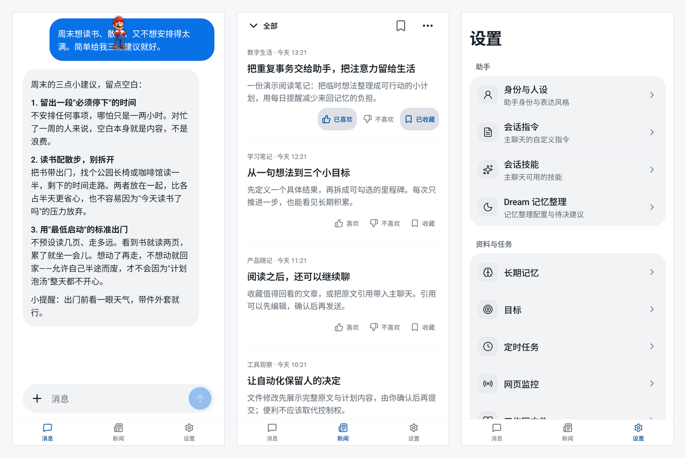
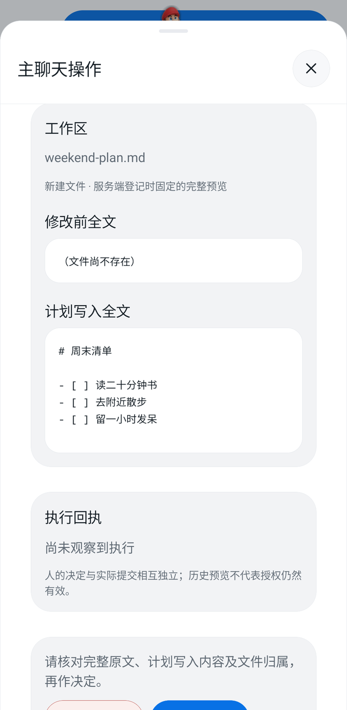
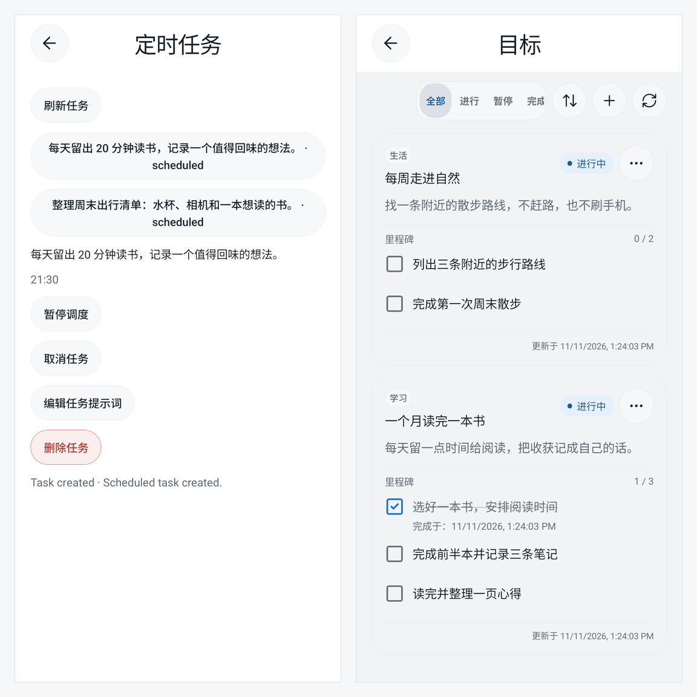

<div align="center">


# Pi Muse

[English](README.md) | [简体中文](README.zh-CN.md)

**A self-hosted AI assistant for your everyday work, built on [pi](https://github.com/earendil-works/pi)**

Chat, read, remember, and follow through on plans—with a native mobile app and a server you control.

**[Download Android APK](https://github.com/yaotutu/pi-muse-mobile/releases/latest/download/app-release.apk)** · [Mobile app](https://github.com/yaotutu/pi-muse-mobile) · [User manual](docs/manual/en/index.md)

[What it does](#what-it-does) · [Quick start](#quick-start) · [Safety and privacy](#safety-and-privacy) · [Development](#development-and-api)



</div>

Screenshots use demo data; the companion pack shown is a replaceable example. This overview describes current source capabilities, not a guarantee that every feature is in the latest published APK. Check the [release notes](https://github.com/yaotutu/pi-muse-mobile/releases/latest) for your installed version.

Individual screens: [Main chat](docs/assets/screenshots/chat.png) · [News](docs/assets/screenshots/news.png) · [Settings](docs/assets/screenshots/settings.png) · [Companion picker](docs/assets/screenshots/companions.png)

## What it does

Pi Muse is a personal, single-user assistant, not a team platform or a chat-platform bot. The server runs the model and background work; the phone gives you a place to talk, read, review changes, and manage the results.

- **One assistant, a direct main chat.** Open Messages and start talking—no conversation picker. Stream replies, attach images or text, review tool activity, and leave message feedback. The server also has topic-session foundations with separate histories and instructions; the mobile app currently exposes only `main`. All sessions share one flat workspace.
- **Reading that leads back to a conversation.** News collects global RSS feeds and recommends articles. Read, save, like, or dislike an article; Discuss appends an editable citation to the existing main draft without sending it. Article content is treated as untrusted external material.
- **Plans that stay visible.** Create one-time or daily tasks and public-page monitors through chat, then manage them in Settings. Monitor intervals start at five minutes. Track longer-term goals with milestones rather than burying progress in chat history.
- **Memory and a personal working style.** Maintain assistant and user profiles, main-chat instructions, skills, and long-term memory. Optional Dream maintenance organizes memories and proposes follow-up items for review.
- **A companion, not another assistant.** A transparent floating character uses eight state poses with subtle, finite animations and a faint silhouette outline. Tap it for main-chat actions, execution, approvals, and history. The built-in penguin is the fallback; complete custom packs installed on the server can be selected on the phone. These are pose images with light motion, not companion videos. Three local themes are available: Classic Blue, Morning Light, and Midnight Black.

### Review file changes before they happen

The model has **no shell tool**. Every workspace `write` or `edit` requires a full before/after preview and explicit human approval bound to that file version. Rejection, expiry, cancellation, or a changed file prevents the pending change from being committed. Instructions and skills cannot bypass this boundary.



### Background work, with clear limits

The server must stay running for scheduled work and monitoring. Schedules support **one-time and daily** jobs, not arbitrary recurrence; missed one-time jobs are not replayed after downtime. Failed jobs do not automatically retry model calls. Goals track deliberate milestone updates, not inferred completion.



Optional Android SMS processing is **off by default** and needs system permission. Important results are appended to main as notifications, without starting an extra main-chat model turn. SMS reception depends on the Android app process being alive; the app does not promise always-on background delivery or lock-screen push notifications.

### A real browser when you need it

With browser tools enabled and a suitable Chrome installation, Pi Muse operates a real graphical Chrome, not a headless substitute. The optional browser Docker deployment includes Chrome and noVNC; the phone's browser viewer and assistant use that same server-side browser and login state. Human takeover uses an authenticated same-origin desktop gateway, not a publicly exposed raw VNC port.

Browser availability depends on deployment and configuration. The noVNC desktop gateway currently does **not** support HTTPS-terminating reverse proxies; follow the [browser deployment guide](docs/manual/en/browser-docker.md) rather than assuming any proxy setup will work.

## Quick start

### 1. Run your server

Use Node.js **24+**, the pnpm version declared in `package.json`, and a model endpoint compatible with Pi Muse's configured pi provider. The current adapter uses pi's `openai-completions` API: an “OpenAI-compatible” label alone does not guarantee that every provider, model, or feature will work. Image understanding also requires a vision-capable model; Pi Muse does not automatically switch models.

On the host that will run the server:

```sh
git clone https://github.com/yaotutu/pi-muse.git
cd pi-muse
pnpm install --frozen-lockfile
mkdir -p .pi-muse
cp -n config.example.json .pi-muse/config.json
chmod 600 .pi-muse/config.json
```

If the configuration already exists, edit it instead of replacing it. Before starting, set a strong random `server.accessKey` and your `model.baseUrl`, `model.id`, and `model.apiKey` in `.pi-muse/config.json`. Use the API base URL, not a full `/chat/completions` endpoint. See [Configuration](docs/manual/en/configuration.md) for model limits and optional tools.

```sh
pnpm build
pnpm start
```

The default API port is `12330`. Open `http://127.0.0.1:12330/docs` on the server host for the running instance's API documentation. For source development, use `pnpm dev` instead.

For the alternative deployment with a full browser desktop, configure the instance first, then follow [Browser Docker](docs/manual/en/browser-docker.md). It uses the same default host API port, so do not start it alongside the local server on that port.

### 2. Connect your phone

1. [Download the latest stable Android APK](https://github.com/yaotutu/pi-muse-mobile/releases/latest/download/app-release.apk), install it, and open Pi Muse. No rebuild is needed for your own server.
2. Open **Server Connection** on the disconnected screen, or **Settings → Server Connection** when connected.
3. Enter the server's base address reachable from the phone, such as `http://192.168.1.100:12330`, and your `server.accessKey`—not the model API key. Do not append `/api` or `/docs`. On a physical phone, `localhost` refers to the phone itself.
4. Tap **Save**. The app verifies the connection before saving. **Test Connection** is optional and does not save it.
5. Open **Messages**, send a message, and confirm a real model reply. A healthy server alone does not prove the model endpoint works.

HTTP works without a domain, certificate, or reverse proxy, but has no transport encryption. Use a trusted network; protect remote access appropriately. Detailed network setup and connection recovery are in [Getting Started](docs/manual/en/getting-started.md).

Android is the directly installable release target. An unsigned iOS IPA, when attached to a release, **cannot be installed directly** and requires your own valid signing credentials and re-signing. The server's `web/` app and Expo Web are development tools, not the primary product client.

## Safety and privacy

- **Your deployment, not offline AI.** The configured external model provider receives the prompts, attachments, and context required for the task. Self-hosting does not keep model requests on your machine.
- **Protect local data.** Conversations, profiles, memory, workspace files, task state, and diagnostic traces are stored locally without encryption at rest. Configuration and signing material are sensitive too; protect the instance directory and backups.
- **Keep credentials separated.** Model keys stay in protected server configuration and memory, not the client or conversation history. The app uses the server AccessKey to authenticate and persists only the server address and Session Token. Switching servers requires confirmation before clearing the old connection's local business caches, credentials, and companion selection; it does not delete remote data.
- **Keep tool boundaries intact.** No shell, workspace-scoped file access, version-bound human approval for model writes, and public HTTP(S) network access with SSRF protections by default. External pages and articles are untrusted data, not instructions that can grant permissions.
- **Know the phone's limits.** Foreground reconnection is not always-on background delivery. Voice input/transcription and lock-screen push notifications are not implemented.

## Development and API

Pi Muse is a single-process modular server built with TypeScript, Hono, and the pi SDK. pi manages assistant execution and session history; Pi Muse adds personal-assistant capabilities, storage, approval boundaries, scheduling, and a public API.

HTTP handles management and requests. Chat uses an **AG-UI SSE execution stream**; the separate **`/api/events` notification stream** carries shared status and invalidation events. Current HTTP/SSE contracts live in `src/http/contracts/` and generate the running instance's `/docs` and `/openapi.json`—use these to build other clients rather than guessing from screenshots.

- [User manual](docs/manual/en/index.md) — installation and daily use
- [Development](docs/development.md) · [Architecture](docs/architecture.md) · [API development](docs/api-development.md)
- [Mobile repository](https://github.com/yaotutu/pi-muse-mobile) — native client and source setup

## Acknowledgements

- [pi](https://github.com/earendil-works/pi) — assistant execution and session management
- [nanobot](https://github.com/HKUDS/nanobot) — personal-assistant design reference
- Muse — interface and interaction design reference
