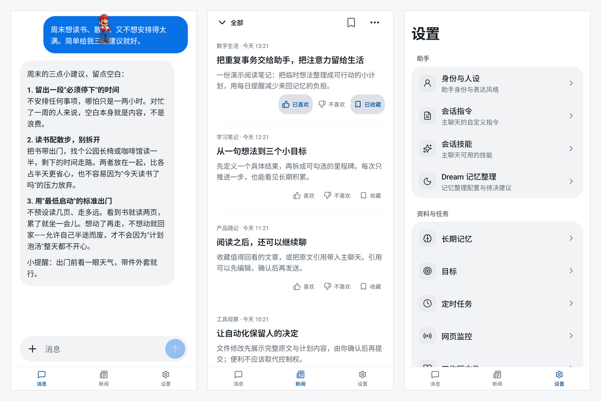
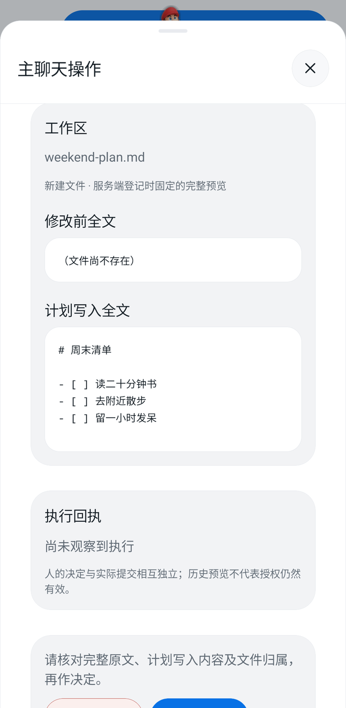
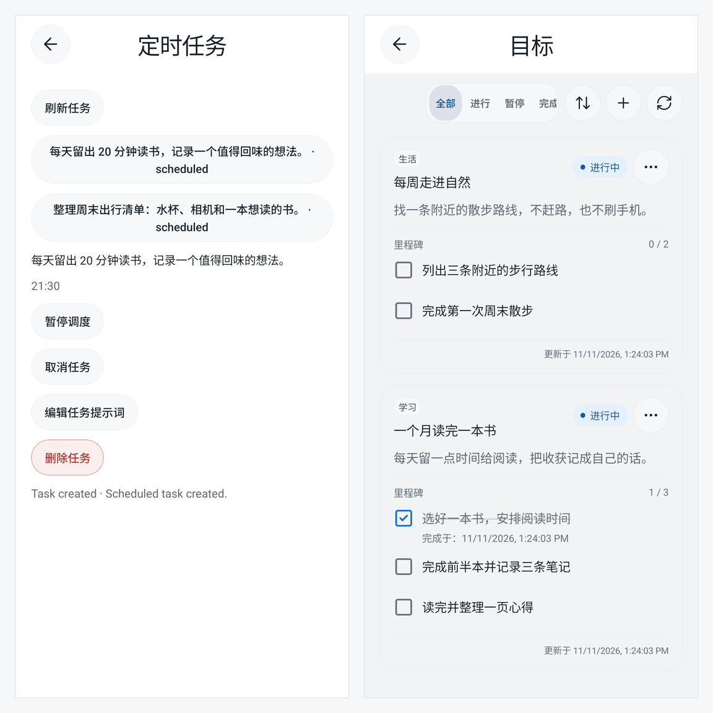

<div align="center">


# Pi Muse

[English](README.md) | [简体中文](README.zh-CN.md)

**基于 [pi](https://github.com/earendil-works/pi) 的自部署 AI 助手，陪你处理日常事务**

聊天、阅读、记忆与计划跟进——用原生手机界面操作，让服务端掌握在自己手里。

**[下载 Android APK](https://github.com/yaotutu/pi-muse-mobile/releases/latest/download/app-release.apk)** · [移动客户端](https://github.com/yaotutu/pi-muse-mobile) · [用户手册](docs/manual/index.md)

[能做什么](#能做什么) · [快速开始](#快速开始) · [安全与隐私](#安全与隐私) · [开发](#开发与-api)



</div>

截图使用演示数据；展示的形象包为可替换示例。本文介绍当前源码能力，不代表最新发布的 APK 已包含每项功能；安装版本请核对[版本说明](https://github.com/yaotutu/pi-muse-mobile/releases/latest)。

查看单图：[主聊天](docs/assets/screenshots/chat.png) · [新闻](docs/assets/screenshots/news.png) · [设置](docs/assets/screenshots/settings.png) · [形象切换](docs/assets/screenshots/companions.png)

## 能做什么

Pi Muse 面向个人自用，是单用户、单一助手，不是团队平台或聊天平台机器人。服务端负责模型执行与后台工作，手机负责对话、阅读、审阅修改和管理结果。

- **单一助手，直接聊天。** 打开「消息」就能交流，不用选择会话。流式查看回复，附上图片或文本，查看工具活动，为消息留下反馈。服务端也具备历史、指令独立的专题会话底座；移动端目前只开放 `main` 主聊天。全部会话共用一个扁平工作区。
- **从阅读自然回到讨论。** 「新闻」全局采集 RSS 并推荐文章，可以阅读、收藏、喜欢或不喜欢。点击「讨论」只向 main 既有草稿追加可编辑引用，不会自动发送；文章内容按不可信外部材料处理。
- **让计划有处可查。** 通过聊天创建一次性或每日任务、公网页面监控，再到设置中管理。监控间隔最短五分钟；长期目标通过里程碑跟进，不把进度埋在聊天记录里。
- **记忆与自己的工作方式。** 维护助手和用户资料、主聊天指令、技能与长期记忆。可选的 Dream 整理记忆，并提出待审阅的后续事项建议。
- **一个形象，不是另一个助手。** 透明悬浮形象用八种状态姿态、有限次轻动效和极淡的剪影描边表达运行状态。点击进入主聊天操作，查看执行、审批和历史。内置企鹅兜底，手机可选择服务端安装的完整自定义形象包。这是姿态图加轻动效，不是形象视频。本机还有经典蓝白、晨光白、深夜黑三套主题。

### 文件修改，先看再批准

模型**没有 Shell 工具**。每次工作区 `write` 或 `edit` 都必须完整预览修改前后内容，由人明确批准，并绑定当时的文件版本。拒绝、过期、取消或文件变化后，该次修改不能提交；指令与技能也不能绕过这条边界。



### 后台工作，也有明确边界

排期和监控需要服务端持续运行。任务只支持**一次性和每日**，不支持任意周期；停机错过的一次性任务不会补跑，失败任务不会自动重试模型调用。目标依靠显式更新里程碑，不从聊天中猜测完成情况。



可选的 Android 短信处理**默认关闭**，需要系统权限。重要结果以通知追加到 main，不额外启动主聊天模型轮。短信接收依赖 Android 应用进程存活；应用不承诺后台常驻交付或锁屏系统推送。

### 需要时，使用真实浏览器

启用浏览器工具并准备好合适的 Chrome 后，Pi Muse 操作的是真实图形化 Chrome，不是 headless 替代。可选的浏览器 Docker 部署包含 Chrome 和 noVNC；手机查看器与助手操作同一个服务端浏览器、共用登录状态。人工接管经过鉴权的同源桌面网关，不直接公开原始 VNC 端口。

浏览器是否可用取决于部署与配置。noVNC 桌面网关目前**不支持 HTTPS 终止反代**，请按[浏览器部署指南](docs/manual/browser-docker.md)配置，不要假设任意代理方案都能工作。

## 快速开始

### 1. 运行自己的服务端

准备 Node.js **24+**、`package.json` 声明的 pnpm 版本，以及与 Pi Muse 当前 pi provider 兼容的模型接口。当前适配器使用 pi 的 `openai-completions` API；仅有“OpenAI 兼容”标签，不代表所有提供方、模型和功能都能使用。图片理解还要求模型本身具备视觉能力，Pi Muse 不会自动换模型。

在准备运行服务端的主机上执行：

```sh
git clone https://github.com/yaotutu/pi-muse.git
cd pi-muse
pnpm install --frozen-lockfile
mkdir -p .pi-muse
cp -n config.example.json .pi-muse/config.json
chmod 600 .pi-muse/config.json
```

如果配置已经存在，直接编辑，不要覆盖。启动前，在 `.pi-muse/config.json` 中设置强随机 `server.accessKey`，以及自己的 `model.baseUrl`、`model.id` 和 `model.apiKey`。地址填写 API 根地址，不是完整的 `/chat/completions` 路径。模型限制和可选工具见[配置说明](docs/manual/configuration.md)。

```sh
pnpm build
pnpm start
```

API 默认端口为 `12330`。在服务端主机打开 `http://127.0.0.1:12330/docs`，查看当前运行实例的接口文档。源码开发可改用 `pnpm dev`。

如需带完整浏览器桌面的替代部署，请先配置实例，再按[浏览器 Docker 说明](docs/manual/browser-docker.md)操作。它使用相同的默认宿主 API 端口，不要与本地服务同时占用该端口。

### 2. 连接手机

1. [下载最新稳定 Android APK](https://github.com/yaotutu/pi-muse-mobile/releases/latest/download/app-release.apk)，安装并打开 Pi Muse。连接自己的服务端不需要重新编译客户端。
2. 未连接时打开首页的「服务器连接」；已连接时进入「设置 → 服务器连接」。
3. 填写手机可访问的服务端根地址，例如 `http://192.168.1.100:12330`，以及 `server.accessKey`，不是模型 API key。不要附加 `/api` 或 `/docs`；真机上的 `localhost` 指向手机本身。
4. 点击「保存」，客户端会先验证连接，再保存。「测试连接」可选，测试本身不会保存。
5. 打开「消息」，发送消息并确认收到真实模型回复；只有服务健康不代表模型接口可用。

直接支持 HTTP，不要求域名、证书或反向代理，但 HTTP 没有传输加密。请优先使用可信网络，并妥善保护远程入口。详细网络设置和连接恢复见[快速上手](docs/manual/getting-started.md)。

Android 是可直接安装的发布目标。Release 如提供未签名 iOS IPA，**不能直接安装**，需要自己的有效签名资格并自行重签。服务端 `web/` 与 Expo Web 都是开发联调工具，不是主要产品客户端。

## 安全与隐私

- **自部署，不等于离线 AI。** 配置的外部模型提供方会收到当前任务所需的提示词、附件和上下文。模型请求不会因为自部署而留在本机。
- **保护本地数据。** 会话、资料、记忆、工作区文件、任务状态和诊断追踪在本地明文保存，没有静态加密。配置和签名材料同样敏感，请保护实例目录与备份。
- **凭据各归其位。** 模型 Key 只留受保护的服务端配置与内存，不进入客户端或聊天历史。App 用服务端 AccessKey 认证，只持久化服务地址和 Session Token。换服务器前需要确认，之后清理旧连接的本机业务缓存、凭据与形象选择，不删除远端数据。
- **工具权限不扩张。** 无 Shell，文件访问限定在工作区，模型写入需版本绑定的人工审批；网络默认只允许公网 HTTP(S)，保留 SSRF 防护。外部网页与文章是不可信数据，不能授予权限。
- **了解手机的边界。** 前台重连不等于后台常驻交付；语音输入／转写和锁屏系统推送尚未实现。

## 开发与 API

Pi Muse 是基于 TypeScript、Hono 和 pi SDK 的单进程模块化服务。pi 管理助手执行与会话历史，Pi Muse 提供个人助手能力、存储、审批边界、调度与公开 API。

HTTP 负责管理与请求。聊天使用 **AG-UI SSE 执行流**，独立的 **`/api/events` 通知流**负责共享状态与失效通知。当前 HTTP/SSE 契约位于 `src/http/contracts/`，生成运行实例的 `/docs` 和 `/openapi.json`；接入其他客户端时以这些为准，不从截图猜协议。

- [用户手册](docs/manual/index.md) — 安装与日常使用
- [开发](docs/development.md) · [架构](docs/architecture.md) · [API 开发](docs/api-development.md)
- [移动端仓库](https://github.com/yaotutu/pi-muse-mobile) — 原生客户端与源码开发

## 致谢

- [pi](https://github.com/earendil-works/pi) — 助手执行与会话管理
- [nanobot](https://github.com/HKUDS/nanobot) — 个人助手设计参考
- Muse — 界面与交互设计参考
