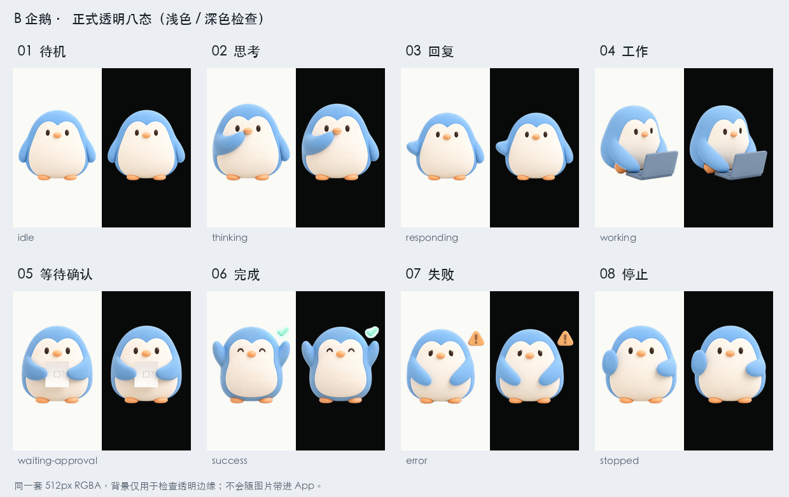

# B 企鹅默认八态包

B 是 Pi Muse 品牌与内置默认虚拟形象的同一个角色。本目录只有一套正式状态资源；不是水管工包，也不是旧毛绒企鹅 C。



## 来源与文件

- 唯一角色母版：[`../previews/neutral-icon-master.png`](../previews/neutral-icon-master.png)。
- idle 使用既有 B 透明母版 [`../mascot/transparent.png`](../mascot/transparent.png)，仅确定性缩放和构图，不重新设计待机角色。
- 另外七态来自用户确认的静态动作原图，原始 JPEG 保留在 `sources/`；来源、尺寸和 SHA-256 见 [`sources/manifest.json`](sources/manifest.json)。这些原稿有不透明背景，不能直接作为透明 PNG 使用。
- 正式资源为 `idle.png`、`thinking.png`、`responding.png`、`working.png`、`waiting-approval.png`、`success.png`、`error.png`、`stopped.png`，均为 512×512 RGBA。输出尺寸、透明主体边界、字节数及 SHA-256 见 [`manifest.json`](manifest.json)。
- 透明处理只去除棚拍背景、接触阴影和边缘底色；保留人物内部、眼部和审批纸张，不修改角色的脸型或颜色。深浅底图仅用于检查，不烘焙进 PNG。

## 可复现构建

使用 Python 3 和 Pillow，不需要网络、凭据或模型：

```sh
python3 docs/assets/brand/companion/build-pack.py
```

脚本先核对原稿与母版哈希，再生成并验证八张 PNG。参数 `--output-dir <output-dir>` 可输出到独立目录；显式传入 `--mobile-assets <mobile-repo>/assets/images/avatar` 时，只会在八张全部检查通过后复制完整图片和清单，不做单张新旧混装。

脚本按画布边缘测量背景、保持封闭的白色道具，清理透明边缘并等比归一到同一 512px 画布与底部基线。它不是通用人像抠图框架；脚边阴影的处理只针对这批已确认原稿。

## 客户端边界

客户端随包保存 PNG 与来源清单副本，运行时不读取服务端仓库文件或下载这些默认图。`builtin:penguin` 的选择 key 与状态机保持不变，变更的是完整默认资源。哈希、PNG 格式、实际透明像素、纸张中心和防裁切回归位于移动端 `tests/builtin-brand-assets.test.mjs`。

水管工等服务端自定义包仍独立可选，不参与品牌或默认角色；旧 C 八图按原字节保存在 [`companion-c` 归档](../../../archive/visual-explorations/companion-c/README.md)。本包是静态姿态图，不是视频。
